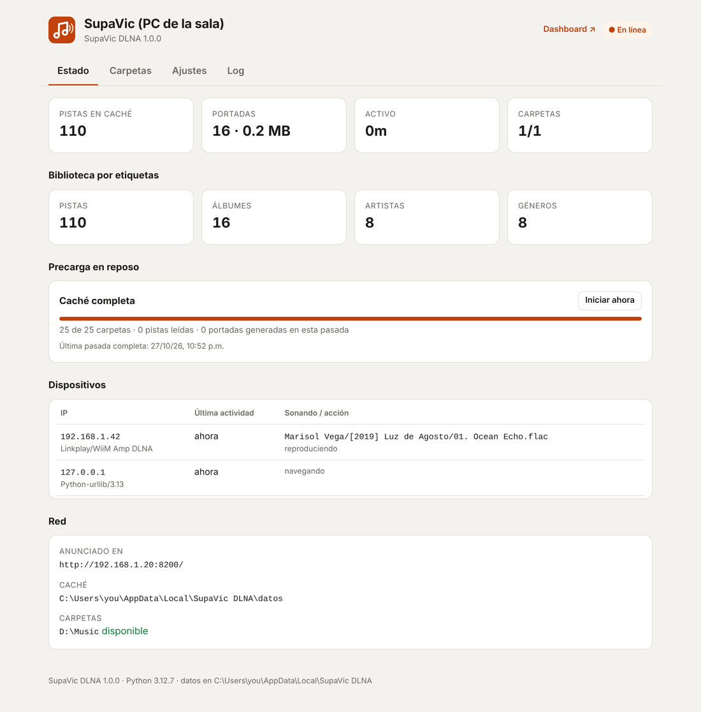
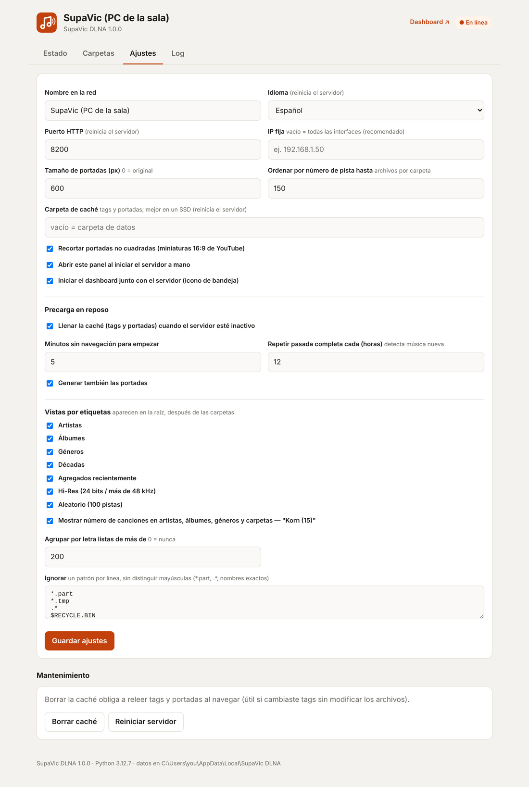
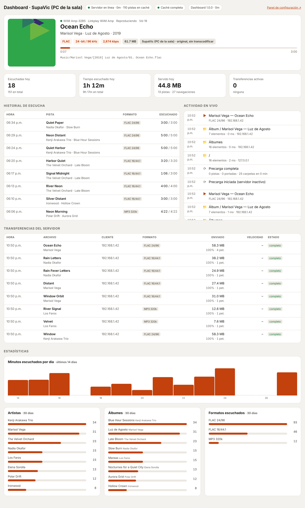
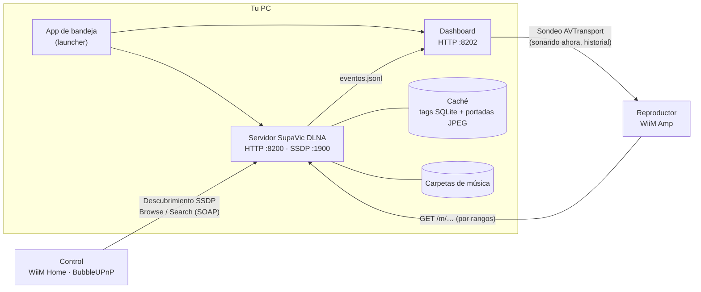

<p align="center">
  
</p>

<h1 align="center">SupaVic DLNA</h1>

<p align="center">
  Un servidor DLNA/UPnP pequeño y rápido para tu biblioteca de música.<br>
  Navega tus carpetas en vivo, o por artista, álbum, género y década, desde WiiM Home, BubbleUPnP o cualquier reproductor UPnP.
</p>

<p align="center">
  <a href="../../releases/latest"><b>Descargar para Windows</b></a> ·
  <a href="#inicio-rápido">Inicio rápido</a> ·
  <a href="#funciones">Funciones</a> ·
  <a href="#preguntas-frecuentes">Preguntas frecuentes</a> ·
  <a href="README.md">English</a>
</p>

<p align="center">
  
  
  
  
</p>

<picture>
  <source media="(prefers-color-scheme: dark)" srcset="docs/img/panel-status-es-dark.png">
  
</picture>

## Por qué

Los servidores multimedia grandes quieren escanear e indexar todo antes de dejarte poner una canción, y mezclan
películas, fotos y música en el mismo árbol. SupaVic DLNA hace una sola cosa: sirve **música**.

- **Tus carpetas aparecen de inmediato.** No hay escaneo previo. Los tags y portadas se leen al abrir una carpeta
  y quedan en caché. El resto de la biblioteca se completa en silencio mientras nadie navega.
- **Archivos originales, intactos.** FLAC 24/192, DSD y MP3 se envían byte por byte, sin transcodificar ni remuestrear.
  Adelantar y regresar usa peticiones HTTP por rangos.
- **Ligero y rápido.** Un solo proceso de Python. En la biblioteca del autor, de 58,000 pistas, una página de carpeta
  carga en unos 10 ms y el índice completo por etiquetas ocupa unos 60 MB de RAM.

Se hizo para un **WiiM Amp** y funciona con cualquier control UPnP/DLNA.

## Inicio rápido

### Windows: instalador (recomendado)

1. Descarga **`SupaVicDLNA-Setup-x.y.z.exe`** de [Releases](../../releases/latest) y ejecútalo.
2. Deja marcada **"Iniciar SupaVic DLNA al iniciar sesión en Windows"**. El instalador también permite la app en tu
   red local en el Firewall de Windows.
3. El panel de control se abre en tu navegador. Ve a **Carpetas → Agregar carpeta…**, elige tu carpeta de música y da clic en **Guardar**.
4. Abre WiiM Home (o BubbleUPnP, mconnect…). El servidor aparece como **SupaVic (*nombre de tu PC*)**.

SupaVic DLNA vive en la **bandeja del sistema**. Con clic derecho en el icono abres el panel de control o el dashboard,
reinicias el servidor, activas o desactivas "Iniciar con Windows", o sales.

> **¿"Windows protegió su PC"?** El ejecutable todavía no está firmado digitalmente, así que SmartScreen puede avisarte
> la primera vez. Da clic en **Más información → Ejecutar de todas formas**. Puedes comprobar la descarga con
> `SHA256SUMS.txt` del release, o usar SupaVic DLNA desde el código fuente.

### Windows: portable

Descarga **`SupaVicDLNA-x.y.z-portable-win64.zip`**, descomprímelo donde quieras y ejecuta `SupaVicDLNA.exe`. La primera
vez pide permiso una sola vez para agregar la regla del firewall. Los ajustes y la caché se guardan en `%LOCALAPPDATA%\SupaVic DLNA`.

### Windows: desde el código fuente (un clic)

Necesitas Git o el ZIP del código. Si falta Python, se instala solo.

```bat
git clone <URL de este repositorio>
cd supavic-dlna
start.bat
```

`start.bat` se encarga de todo:

- busca Python 3.9+, o instala Python 3.12 con `winget`
- crea `.venv` e instala las dependencias
- agrega la regla del firewall (pide permiso de administrador una vez)
- crea los accesos directos en el menú Inicio y el Escritorio, activa "Iniciar con Windows" e inicia el servidor

Si lo vuelves a ejecutar, reinicia el servidor, lo cual sirve tras un `git pull`. `stop.bat` lo detiene y `uninstall.bat`
deshace todo excepto tu música.

### Linux / macOS (desde el código)

```bash
git clone <URL de este repositorio> && cd supavic-dlna
./start.sh            # crea .venv, instala dependencias y corre en primer plano
```

Abre `http://<este-equipo>:8200/` para agregar tus carpetas. Hay una unidad de systemd en
[`contrib/supavic-dlna.service`](contrib/supavic-dlna.service). El servidor funciona bien en Linux. En macOS no se ha
probado, y fuera de Windows no hay icono de bandeja.

## Funciones

### Lo que ves en tu reproductor

```
SupaVic (PC de la sala)
├── 📁 Música (1,240)                ← tus carpetas, en vivo desde el disco, con número de canciones
│   └── 📁 Kenji Arakawa Trio (11)
│       ├── ▶ Todas las pistas (11)  ← reproduce un artista o un árbol de carpetas completo
│       ├── 📁 [1998] Blue Hour Sessions (6)
│       └── 📁 [2005] Afterglow (5)
├── Artistas                 → ▶ Todas las pistas · álbumes por año original: "Afterglow [2005]"
├── Artistas (por pista)     → (opcional) todos los que aparecen en una pista, featuring incluidos
├── Álbumes                  → grupos A–Z cuando la lista es larga
├── Géneros                  → artistas → álbumes
├── Décadas                  → álbumes por año
├── Agregados recientemente  → los 200 álbumes más nuevos
├── Hi-Res                   → álbumes de más de 16 bits o 48 kHz
└── Aleatorio                → 100 pistas, se rebaraja cada 10 minutos
```

- **Carpetas en vivo**: ves lo que hay en el disco ahora. Las carpetas nuevas, movidas o renombradas aparecen al
  instante, y los reproductores reciben aviso de los cambios.
- **Vistas por etiquetas** al estilo MinimServer y MusicBee, construidas desde la caché. Usan el artista del álbum,
  tags multivalor (campos `ARTIST=`/`GENRE=` repetidos, o separados con `;` y `/`), `originaldate`, `albumsort` y la
  marca de compilación, detectan "Varios artistas" y ordenan de forma natural ignorando acentos y "The". Los álbumes
  con el mismo título y artista en carpetas distintas (reediciones, discos homónimos) quedan separados, y las
  subcarpetas `CD1`/`Disc 2` se juntan en un solo álbum. Las compilaciones se ordenan por título (o `albumsort`).
- **▶ Todas las pistas** en cada nivel que lista contenedores, en orden de navegación y sin duplicados.
- **Conteos** en el título: canciones (`Korn (15)`), elementos (`Korn (4)` álbumes) o nada. El año después del título
  del álbum también es opcional, igual que agrupar tus carpetas dentro de una entrada "Carpetas" en la raíz.
- **Búsqueda UPnP** por título, artista, álbum y género.
- **IDs estables**: los favoritos y presets de tu reproductor siguen funcionando tras reiniciar.

### Audio y portadas

- Formatos: FLAC, ALAC/AAC/M4A, MP3, OGG Vorbis, Opus, WAV, AIFF, DSF/DFF, WavPack, APE.
- Envía el **archivo original** con peticiones por rangos (para adelantar) y los encabezados DLNA correctos.
- Los metadatos de cada pista incluyen duración, frecuencia, bits, canales y bitrate, así el reproductor puede mostrar "FLAC 24/96".
- Las portadas salen de `cover.jpg` / `folder.jpg` / `front.jpg`… o de la imagen incrustada. Se redimensionan a JPEG
  (600 px por defecto, perfil DLNA `JPEG_SM`), y las miniaturas 16:9 se recortan a cuadrado. Cada álbum comparte una
  sola portada, así el reproductor la descarga una vez.

### Rápido sin indexar

- Los tags se guardan en una caché SQLite y se validan con el tamaño y la fecha de modificación.
- Un lector rápido de FLAC lee solo los bloques de cabecera: unos KB por archivo, no la imagen incrustada completa.
- Al abrir una carpeta, los tags se leen en paralelo. Lo que tarde más de 1.5 s aproximadamente se muestra con
  nombres sacados de la ruta (`Artista/[Año] Álbum/NN. Título`) y se termina en segundo plano.
- **Precarga en reposo**: tras 5 minutos sin navegación, recorre la biblioteca y guarda en caché tags y portadas.
  Se pausa en cuanto alguien navega o reproduce, y limpia las entradas de archivos borrados.
- La caché sobrevive a **mover o renombrar carpetas**: los archivos se reconocen por nombre, tamaño y fecha.
- La caché puede vivir en otro disco, por ejemplo un SSD (`Ajustes → Carpeta de caché`).

### Panel de control y dashboard

| Panel de control (`:8200`) | Dashboard (`:8202`) |
|---|---|
|  |  |

- **Panel de control**: estado, dispositivos conectados, progreso de la precarga, selector de carpetas, todos los
  ajustes, herramientas de caché y el log.
- **Dashboard**: qué está sonando ahora en cada reproductor (formato, posición, volumen), el historial de escucha
  (pistas escuchadas más de 10 s), la actividad en vivo, las transferencias del servidor y estadísticas de 14 y 30 días.
  Corre como un proceso aparte, así que puedes reiniciarlo sin tocar el servidor.
- Los dos tienen tema claro y oscuro y funcionan en el celular. Están en **español e inglés**, igual que los nombres de
  carpetas que ve tu reproductor (*Ajustes → Idioma*, o automático).

### Integración con Windows

- Icono en la bandeja, inicio con Windows e instancia única: si lo abres otra vez, solo abre el panel.
- Versiones con instalador y portable, compiladas por GitHub Actions en cada release.
- La regla del firewall solo permite **tu subred local**. Los ajustes solo se pueden cambiar desde IPs privadas.
  Nada sale de tu red: sin telemetría y sin nube.

## Cómo funciona



1. El servidor se anuncia por SSDP en todas las interfaces de red locales y responde a cada cliente con la IP
   correcta, así que también funciona si tienes adaptadores de VPN o Hyper-V.
2. Tu app de control navega con `ContentDirectory:Browse`. Las carpetas se listan directo del disco, y las vistas por
   etiquetas salen de un índice en memoria construido desde la caché, que se reconstruye en segundo plano como mucho
   una vez por minuto.
3. El reproductor descarga el archivo original por HTTP.
4. El dashboard lee la bitácora de eventos del servidor y consulta a los reproductores por UPnP qué está sonando de verdad.

## Configuración

Todo se edita desde el panel de control (**Ajustes**). Se guarda en `config.json`:

| Dónde | Cuándo |
|---|---|
| `%LOCALAPPDATA%\SupaVic DLNA\` | instalador o `.exe` portable |
| junto a `main.py` | desde el código fuente |
| `$SUPAVIC_HOME` | si esa variable de entorno está definida |

La tabla con todas las claves está en el [README en inglés](README.md#configuration). Las más útiles:

| Clave | Por defecto | Qué hace |
|---|---|---|
| `servidor.nombre` | `SupaVic (<nombre del PC>)` | Nombre que ven tus reproductores |
| `servidor.puerto` | `8200` | Puerto HTTP (servidor y panel) |
| `servidor.ip` | vacío | Vacío = anunciar en todas las interfaces. Pon una IP para usar solo esa |
| `servidor.idioma` | `auto` | `auto`, `es` o `en` |
| `musica.carpetas` | `[]` | Tus carpetas de música |
| `cache.directorio` | vacío | Carpeta de caché (vacío = `datos\` en la carpeta de datos) |
| `precarga.inactividad_min` | `5` | Minutos sin navegación antes de precargar |
| `vistas.activas` | todas | `artistas`, `albumes`, `generos`, `decadas`, `recientes`, `hires`, `aleatorio` |

**Puertos:** TCP 8200 (servidor y panel), TCP 8202 (dashboard), UDP 1900 (descubrimiento SSDP).

## Preguntas frecuentes

<details>
<summary><b>Mi reproductor no ve el servidor</b></summary>

- La PC y el reproductor deben estar en la misma red (misma subred). Las redes Wi-Fi de invitados suelen aislar a los equipos.
- Revisa la regla del firewall: `netsh advfirewall firewall show rule name="SupaVic DLNA"`. Reinstalar, o ejecutar
  `start.bat` desde el código, la vuelve a crear.
- Si tu PC tiene varios adaptadores de red (VPN, Hyper-V, Docker), revisa **Estado → Red** para ver dónde se anuncia.
  Si hace falta, pon la IP de tu red en **Ajustes → IP fija**.
- Reinicia la app del reproductor. Algunas guardan la lista de servidores.
</details>

<details>
<summary><b>¿Transcodifica o remuestrea?</b></summary>

No. El reproductor recibe el archivo original byte por byte. Lo que el reproductor haga después, como volumen, EQ o
remuestreo, depende de sus propios ajustes.
</details>

<details>
<summary><b>Cambié los tags pero el reproductor muestra los viejos</b></summary>

Los tags se vuelven a leer cuando cambia el tamaño o la fecha de modificación del archivo. Si tu editor de tags
conserva la fecha, usa **Ajustes → Borrar caché**.
</details>

<details>
<summary><b>Los álbumes nuevos todavía no salen en Artistas / Álbumes / Géneros</b></summary>

Las carpetas siempre se navegan en vivo. Las vistas por etiquetas incluyen lo que ya está en caché: lo que hayas
navegado, más todo lo demás tras una pasada de precarga. Da clic en **Estado → Precarga en reposo → Iniciar ahora**
para actualizarlas al momento.
</details>

<details>
<summary><b>Mi antivirus marca el .exe</b></summary>

A veces los ejecutables hechos con PyInstaller dan falsos positivos. Puedes compilarlo tú mismo (`build\build.bat`)
o usar SupaVic DLNA desde el código con `start.bat`.
</details>

<details>
<summary><b>¿Dónde están los logs?</b></summary>

En **Panel de control → Log**, o en `datos\servidor.log` y `datos\dashboard.log` dentro de la carpeta de datos. El
menú de la bandeja tiene **Abrir carpeta de datos**.
</details>

## Desinstalar

- **Instalador:** *Configuración → Aplicaciones → SupaVic DLNA → Desinstalar*. También quita la regla del firewall y
  "Iniciar con Windows". Tus ajustes y la caché se quedan en `%LOCALAPPDATA%\SupaVic DLNA`; borra esa carpeta si quieres.
- **Portable:** sal desde la bandeja, desactiva antes "Iniciar con Windows" si lo activaste, y borra la carpeta y
  `%LOCALAPPDATA%\SupaVic DLNA`.
- **Desde el código:** `uninstall.bat`.

Tu música nunca se modifica ni se borra.

## Compilar

```bat
build\build.bat
```

Crea `dist\SupaVicDLNA\` (el programa), un ZIP portable y, si tienes [Inno Setup 6](https://jrsoftware.org/isinfo.php),
el instalador.

Los releases son automáticos. Sube `VERSION` en `main.py`, actualiza `CHANGELOG.md` y `docs/release-notes.md`, y luego
sube una etiqueta que coincida con la versión:

```bash
git tag v1.0.0 && git push origin v1.0.0
```

El workflow [Build Windows release](.github/workflows/release.yml) compila el instalador, el ZIP portable y
`SHA256SUMS.txt`, y los adjunta a un GitHub Release.

## Contribuir

Los issues y pull requests son bienvenidos. Incluye tu sistema operativo, tu reproductor o app (WiiM Home, BubbleUPnP…)
y las líneas relevantes del log. El código está comentado en español. Lee [`AGENTS.md`](AGENTS.md) para un recorrido
por la arquitectura.

## Licencia

[MIT](LICENSE) © SupaVic. Los componentes de terceros están en [THIRD_PARTY_NOTICES.md](THIRD_PARTY_NOTICES.md).

SupaVic DLNA es un proyecto independiente y no tiene relación con WiiM / Linkplay. Los nombres de productos son marcas
de sus respectivos dueños. Las capturas usan una biblioteca de demostración con artistas inventados.
