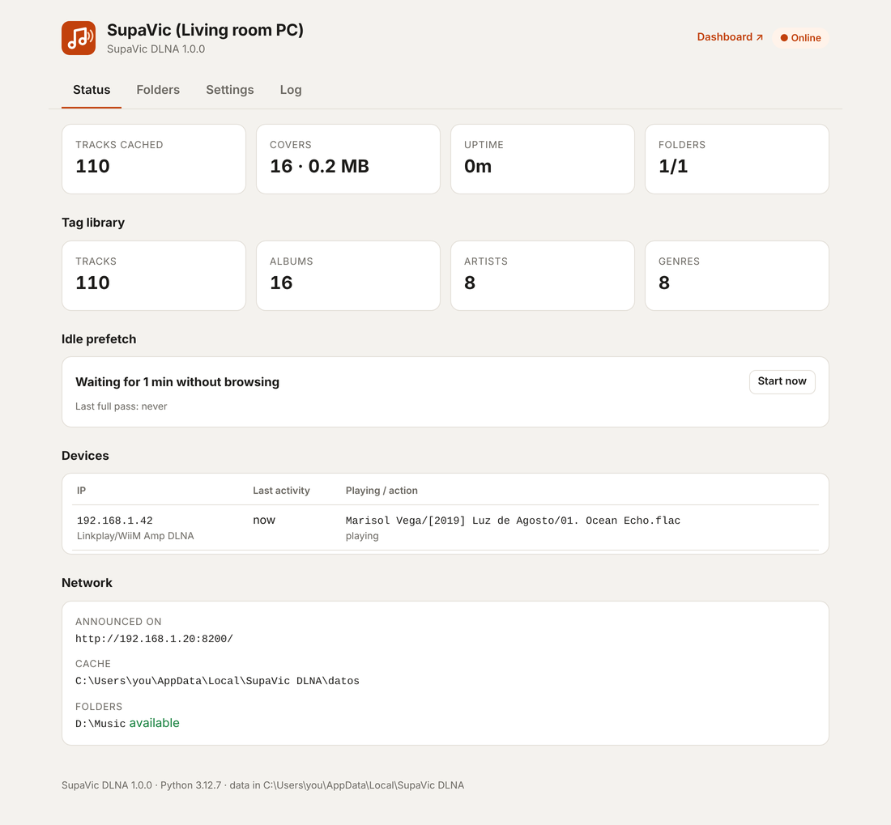
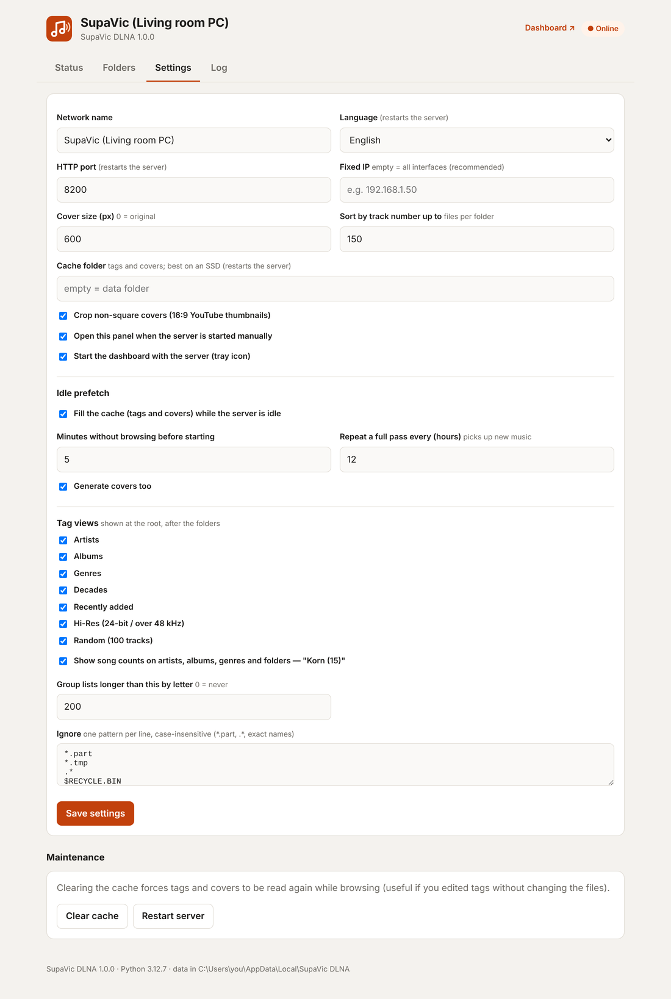
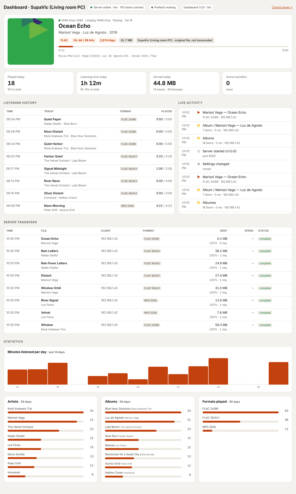
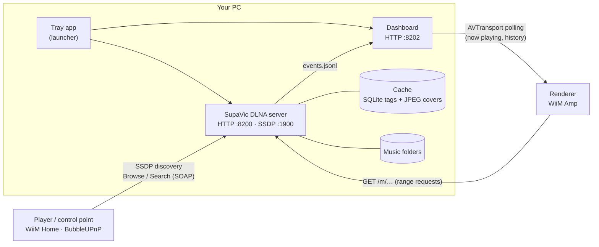

<p align="center">
  
</p>

<h1 align="center">SupaVic DLNA</h1>

<p align="center">
  A tiny, fast DLNA/UPnP server for your music library.<br>
  Browse your folders live, or by artist, album, genre and decade, on WiiM Home, BubbleUPnP or any UPnP player.
</p>

<p align="center">
  <a href="../../releases/latest"><b>Download for Windows</b></a> ·
  <a href="#quick-start">Quick start</a> ·
  <a href="#features">Features</a> ·
  <a href="#faq--troubleshooting">FAQ</a> ·
  <a href="README.es.md">Español</a>
</p>

<p align="center">
  
  
  
  
</p>

<picture>
  <source media="(prefers-color-scheme: dark)" srcset="docs/img/panel-status-en-dark.png">
  
</picture>

## Why

Big media servers want to scan and index everything before you can play a song, and they mix movies, photos and
music in the same tree. SupaVic DLNA does one thing: it serves **music**.

- **Your folders show up right away.** There's no up-front scan. Tags and covers are read when you open a folder and
  then cached. The rest of the library is filled in quietly while nobody is browsing.
- **Original files, untouched.** FLAC 24/192, DSD and MP3 are streamed byte for byte, with no transcoding and no resampling.
  Seeking uses HTTP range requests.
- **Small and quick.** One Python process. On the author's 58,000-track library a folder page loads in about 10 ms
  and the whole tag index takes roughly 60 MB of RAM.

It was built for a **WiiM Amp** and works with any UPnP/DLNA control point.

## Quick start

### Windows: installer (recommended)

1. Download **`SupaVicDLNA-Setup-x.y.z.exe`** from [Releases](../../releases/latest) and run it.
2. Leave **"Start SupaVic DLNA when I sign in to Windows"** ticked. The installer also allows the app on your
   local network in Windows Firewall.
3. The control panel opens in your browser. Go to **Folders → Add folder…**, pick your music folder and click **Save**.
4. Open WiiM Home (or BubbleUPnP, mconnect…). The server appears as **SupaVic (*your PC's name*)**.

SupaVic DLNA runs in the **system tray**. Right-click the icon to open the control panel or the dashboard, restart
the server, turn "Start with Windows" on or off, or quit.

> **"Windows protected your PC"?** The executable isn't code-signed yet, so SmartScreen may warn you the first
> time. Click **More info → Run anyway**. You can check the download against `SHA256SUMS.txt` from the release,
> or run SupaVic DLNA from source instead.

### Windows: portable

Download **`SupaVicDLNA-x.y.z-portable-win64.zip`**, unzip it anywhere and run `SupaVicDLNA.exe`. On the first run it
asks once for permission to add the firewall rule. Settings and cache are kept in `%LOCALAPPDATA%\SupaVic DLNA`.

### Windows: from source (one click)

You need Git or the source ZIP. Python is installed for you if it's missing.

```bat
git clone <this repository URL>
cd supavic-dlna
start.bat
```

`start.bat` takes care of everything:

- finds Python 3.9+, or installs Python 3.12 with `winget`
- creates `.venv` and installs the dependencies
- adds the firewall rule (it asks for administrator permission once)
- creates the Start menu and Desktop shortcuts, turns on "Start with Windows" and starts the server

Running it again restarts the server, which is handy after a `git pull`. `stop.bat` stops it and `uninstall.bat`
undoes everything except your music.

### Linux / macOS (from source)

```bash
git clone <this repository URL> && cd supavic-dlna
./start.sh            # creates .venv, installs the dependencies, runs in the foreground
```

Open `http://<this-machine>:8200/` to add your folders. There's a systemd unit in
[`contrib/supavic-dlna.service`](contrib/supavic-dlna.service). The server runs fine on Linux. macOS is untested,
and there's no tray icon outside Windows.

### Docker (from source)

Using the Makefile:

``` bash
make build
make run
```

Using command line:

``` bash
docker build -t supavic-dlna-test .
docker run --rm --net=host --name supavic supvic-dlna-test
```

Using docker compose:

`docker compose up`

Example docker-compose.yml:

``` yaml
services:
  supavic-dlna:
    build: .
    image: supavic-dlna-test
    container_name: supavic-dlna
    restart: unless-stopped
    network_mode: host
    volumes:
      - /home/CHANGE_ME/music:/music:ro
      #- music:/music:ro
    environment:
      - TZ=UTC

#volumes:
#  music:
#    driver_opts:
#      type: "nfs"
#      o: "addr=192.168.1.200,nolock,soft,nfsvers=4"
#      device: ":/mnt/tank/music"
```

## Features

### Browsing on your player

```
SupaVic (Living room PC)
├── 📁 Music (1,240)                 ← your folders, live from disk, with song counts
│   └── 📁 Kenji Arakawa Trio (11)
│       ├── ▶ All tracks (11)        ← play a whole artist or folder tree at once
│       ├── 📁 [1998] Blue Hour Sessions (6)
│       └── 📁 [2005] Afterglow (5)
├── Artists          → ▶ All tracks · albums by original year: "Afterglow [2005]"
├── Track artists    → (optional) everyone who appears on a track, featuring included
├── Albums           → A–Z groups when the list is long
├── Genres           → artists → albums
├── Decades          → albums by year
├── Recently added   → newest 200 albums
├── Hi-Res           → albums over 16-bit or 48 kHz
└── Random           → 100 tracks, reshuffled every 10 minutes
```

- **Live folders**: what's on disk now is what you see. New, moved and renamed folders show up right away, and
  players are notified of changes.
- **Tag views** in the style of MinimServer and MusicBee, built from the cache. They use album artist,
  multi-valued tags (repeated `ARTIST=`/`GENRE=` fields, or `;` and `/` separators), `originaldate`,
  `albumsort` and the compilation flag, "Various Artists" detection, and natural sorting that ignores accents and
  "The". Albums with the same title and artist in different folders (reissues, self-titled albums) stay separate,
  while `CD1`/`Disc 2` subfolders are merged into one album. Compilations are sorted by title (or `albumsort`).
- **▶ All tracks** at every level that lists containers, in browse order with no duplicates.
- **Counts** in titles: songs (`Korn (15)`) or items (`Korn (4)` albums), or none. The year after the album title
  is optional too, and so is putting your folders inside a "Folders" entry at the root.
- **UPnP Search** across title, artist, album and genre.
- **Stable IDs**: favorites and presets on your player keep working after restarts.

### Audio and artwork

- Formats: FLAC, ALAC/AAC/M4A, MP3, OGG Vorbis, Opus, WAV, AIFF, DSF/DFF, WavPack, APE.
- Streams the **original file** with range requests (seeking) and proper DLNA headers.
- Track metadata includes duration, sample rate, bit depth, channels and bitrate, so players can show "FLAC 24/96".
- Covers come from `cover.jpg` / `folder.jpg` / `front.jpg`… or from the embedded picture. They're resized to
  JPEG (600 px by default, the DLNA `JPEG_SM` profile), and 16:9 thumbnails are cropped to a square.
  Each album gets one shared cover, so the player downloads it only once.

### Fast without indexing

- Tags are cached in SQLite and checked against file size and modification time.
- A fast FLAC reader parses only the header blocks: a few KB per file instead of the full embedded picture.
- When you open a folder, tags are read in parallel. Anything that takes longer than about 1.5 s is shown with
  names taken from the path (`Artist/[Year] Album/NN. Title`) and finished in the background.
- **Idle prefetch**: after 5 minutes without browsing, it walks the library and caches tags and covers. It
  pauses the moment someone browses or plays, and clears out entries for deleted files.
- The cache survives **moving or renaming folders**: files are matched by name, size and timestamp.
- The cache can live on another drive, such as an SSD (`Settings → Cache folder`).

### Control panel and dashboard

| Control panel (`:8200`) | Dashboard (`:8202`) |
|---|---|
|  |  |

- **Control panel**: status, connected devices, prefetch progress, folder picker, every setting, cache tools and the log.
- **Dashboard**: what each player is playing right now (format, position, volume), a listening history
  (tracks played for more than 10 s), live activity, server transfers and 14-day/30-day stats. It runs as a
  separate process, so you can restart it without touching the server.
- Both have light and dark themes and work on a phone. They're in **English and Spanish**, as are the folder
  names your player shows (*Settings → Language*, or automatic).

### Desktop integration

- System tray icon, start with Windows, single instance: opening it again just opens the panel.
- Installer and portable builds, created by GitHub Actions on every release.
- The firewall rule only allows **your local subnet**. Changing settings is only possible from private IPs.
  Nothing leaves your network: no telemetry and no cloud.

## How it works



1. The server announces itself with SSDP on every local network interface and answers with the right IP for each
   client, so it also works when you have VPN or Hyper-V adapters.
2. Your control app browses with `ContentDirectory:Browse`. Folders are listed straight from disk, and tag views
   come from an in-memory index built from the cache and rebuilt in the background at most once a minute.
3. The renderer downloads the original file over HTTP.
4. The dashboard reads the server's event log and polls renderers over UPnP to see what's actually playing.

## Configuration

Everything is editable in the control panel (**Settings**). It's stored in `config.json`:

| Where | When |
|---|---|
| `%LOCALAPPDATA%\SupaVic DLNA\` | installer or portable `.exe` |
| next to `main.py` | running from source |
| `$SUPAVIC_HOME` | if that environment variable is set |

| Key | Default | What it does |
|---|---|---|
| `servidor.nombre` | `SupaVic (<PC name>)` | Name shown on your players |
| `servidor.puerto` | `8200` | HTTP port (server and control panel) |
| `servidor.ip` | empty | Empty = announce on every interface. Set an IP to use only one |
| `servidor.idioma` | `auto` | `auto`, `en` or `es` (player folder names, panel and dashboard) |
| `servidor.abrir_navegador` | `true` | Open the panel when you start the app yourself (never at Windows sign-in) |
| `musica.carpetas` | `[]` | Your music folders. With a single folder, its subfolders show at the root |
| `musica.ignorar` | `*.part`, `.*`, … | Name patterns to hide (case-insensitive) |
| `musica.ordenar_por_tags_hasta` | `150` | Folders with up to this many files are sorted by disc/track number |
| `musica.agrupar_carpetas` | `false` | Show your folders inside a "Folders" entry at the root instead of directly at the root |
| `portadas.tamano` | `600` | Cover size in px (`0` = original file) |
| `portadas.recortar_cuadrado` | `true` | Crop non-square covers |
| `precarga.activa` | `true` | Idle prefetch of tags and covers |
| `precarga.inactividad_min` | `5` | Minutes without browsing before prefetch starts |
| `precarga.repetir_horas` | `12` | Full pass interval (finds new music) |
| `vistas.activas` | all but `interpretes` | `artistas`, `interpretes` (track artists), `albumes`, `generos`, `decadas`, `recientes`, `hires`, `aleatorio` |
| `vistas.agrupar_desde` | `200` | Group longer lists by letter (`0` = never) |
| `vistas.mostrar_conteo` | `true` | Count in parentheses after titles |
| `vistas.tipo_conteo` | `pistas` | `pistas` = songs; `elementos` = an artist's albums, a genre's artists… (albums get no number) |
| `vistas.mostrar_anio` | `true` | Year after the album title: `Album [1999]` |
| `dashboard.puerto` | `8202` | Dashboard port |
| `dashboard.con_servidor` | `true` | The tray app starts and stops the dashboard with the server |
| `dashboard.renderers` | `[]` | Extra `description.xml` URLs if a player isn't discovered |
| `cache.directorio` | empty | Cache folder (empty = `datos\` in the data folder) |

**Network ports:** TCP 8200 (server and panel), TCP 8202 (dashboard), UDP 1900 (SSDP discovery).

## FAQ / troubleshooting

<details>
<summary><b>My player doesn't see the server</b></summary>

- The PC and the player must be on the same network (same subnet). Guest Wi-Fi networks often isolate devices.
- Check the firewall rule: `netsh advfirewall firewall show rule name="SupaVic DLNA"`. Reinstalling, or running
  `start.bat` from source, adds it again.
- If your PC has several network adapters (VPN, Hyper-V, Docker), look at **Status → Network** to see where it's
  announced. If needed, set your LAN IP under **Settings → Fixed IP**.
- Restart the player app. Some apps cache the server list.
</details>

<details>
<summary><b>Does it transcode or resample?</b></summary>

No. The renderer receives the original file byte for byte. What your player does with it, such as volume,
EQ or resampling, depends on the player's own settings.
</details>

<details>
<summary><b>I edited tags but the player still shows the old ones</b></summary>

Tags are re-read when a file's size or modified time changes. If your tag editor keeps the timestamp, use
**Settings → Clear cache**.
</details>

<details>
<summary><b>New albums aren't in Artists / Albums / Genres yet</b></summary>

Folder browsing is always live. Tag views include what's already in the cache: anything you've browsed, plus
everything after a prefetch pass. Click **Status → Idle prefetch → Start now** to refresh them right away.
</details>

<details>
<summary><b>My antivirus flags the .exe</b></summary>

Executables built with PyInstaller sometimes get false positives. You can build it yourself
(`build\build.bat`) or run SupaVic DLNA from source with `start.bat`.
</details>

<details>
<summary><b>Where are the logs?</b></summary>

In **Control panel → Log**, or in `datos\servidor.log` and `datos\dashboard.log` inside the data folder. The tray
menu has **Open data folder**.
</details>

## Uninstall

- **Installer:** *Settings → Apps → SupaVic DLNA → Uninstall*. This also removes the firewall rule and
  "Start with Windows". Your settings and cache stay in `%LOCALAPPDATA%\SupaVic DLNA`; delete that folder if you want.
- **Portable:** quit from the tray, turn off "Start with Windows" first if you enabled it, then delete the folder
  and `%LOCALAPPDATA%\SupaVic DLNA`.
- **From source:** `uninstall.bat`.

Your music is never modified or deleted.

## Building

```bat
build\build.bat
```

This creates `dist\SupaVicDLNA\` (the program), a portable ZIP and, if [Inno Setup 6](https://jrsoftware.org/isinfo.php)
is installed, the installer.

Releases are automated. Bump `VERSION` in `main.py`, update `CHANGELOG.md` and `docs/release-notes.md`, then push a
tag that matches the version:

```bash
git tag v1.0.0 && git push origin v1.0.0
```

The [Build Windows release](.github/workflows/release.yml) workflow builds the installer, the portable ZIP and
`SHA256SUMS.txt`, and attaches them to a GitHub Release.

### Project layout

| File | What it is |
|---|---|
| `main.py` | The DLNA server: SSDP, ContentDirectory, streaming, cache, tag index and control panel. Standard library + mutagen + Pillow |
| `dashboard.py` | Dashboard (separate process, standard library only) |
| `launcher.py` | Tray app and entry point of the `.exe`: single instance, start with Windows, firewall prompt |
| `i18n.py` | English and Spanish strings |
| `start.bat` · `stop.bat` · `uninstall.bat` · `start.sh` | One-click scripts for running from source |
| `build/` | PyInstaller spec, Inno Setup script, local build script |

## Contributing

Issues and pull requests are welcome. Please include your OS, player or app (WiiM Home, BubbleUPnP…) and the
relevant lines from the log. The code is commented in Spanish. See [`AGENTS.md`](AGENTS.md) for an architecture
tour.

## License

[MIT](LICENSE) © SupaVic. Third-party components are listed in [THIRD_PARTY_NOTICES.md](THIRD_PARTY_NOTICES.md).

SupaVic DLNA is an independent project and is not affiliated with WiiM / Linkplay. Product names are trademarks of
their respective owners. Screenshots use a demo library with made-up artists.
